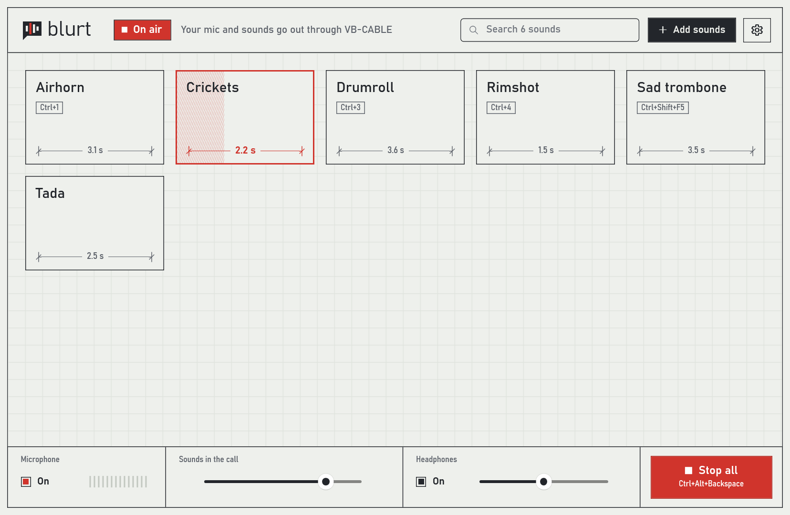
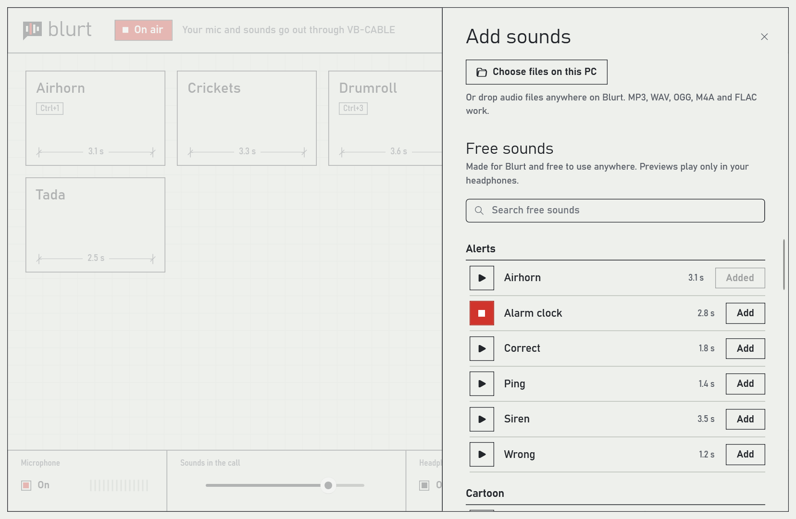

# Blurt: free, open-source soundboard for Windows

Play sounds through your mic in Discord, TeamSpeak, Zoom and any game with voice chat. Your friends hear your voice and the airhorn together. You hear the airhorn, never yourself.



**[Download Blurt for Windows](../../releases/latest)**. It runs on 64-bit Windows 10 and 11. The installer is not code-signed, so Windows may say it protected your PC: choose **More info**, then **Run anyway**.

## Why do I need VB-CABLE?

Windows lets an app send audio to your speakers, not into another app's microphone. Blurt gets around that with [VB-CABLE](https://vb-audio.com/Cable/), a free virtual audio cable. Blurt mixes your mic with your sounds and plays the mix into one end of the cable. Your voice app uses the other end as its microphone.

```
microphone ──┐
             ├──► Blurt ──► VB-CABLE ──► Discord, TeamSpeak, your game
sounds ──────┘      │
                    └─────► your headphones (sounds only)
```

## Set up in three steps

1. Install [VB-CABLE](https://vb-audio.com/Cable/). Run its setup as administrator, then restart Windows.
2. Install Blurt from the [latest release](../../releases/latest). It installs for your Windows user only, so it asks for no admin rights, and it finds the cable by itself.
3. In your voice app or game, set the microphone to **CABLE Output (VB-Audio Virtual Cable)** and turn off noise suppression, or the app filters your sounds out as noise.

Blurt shows these steps on first start, with a button that plays a test chime into the cable. If a game has no microphone setting, set CABLE Output as the Windows default input under Settings › System › Sound › Input.

## What it does

- Click a pad to play its sound, and click again to stop it. Right-click a pad, or use its **⋯** button, to give it a key combination. Keys work while your game has focus, and <kbd>Ctrl</kbd>+<kbd>Alt</kbd>+<kbd>Backspace</kbd> stops everything.
- 34 free sounds come with it: airhorn, rimshot, sad trombone, drumroll, crickets and more, in six categories under **Add sounds**. All are synthesized from scratch and released under CC0.
- Drag your own MP3, WAV, OGG, M4A, AAC, WMA or FLAC files onto the window. Blurt evens out their loudness, so a quiet clip and a loud one play at about the same level.
- To other apps Blurt is a normal microphone, so their push to talk and voice activity settings apply to your sounds too.
- Your sounds live in a `sounds` folder next to `Blurt.exe`. Moving the folder moves everything.



## Questions

### Does it work with my game?

If the game or app lets you choose a microphone, or uses the Windows default one, yes. Blurt does nothing app-specific: to the game it is a microphone like any other.

### Is this a free alternative to Soundpad or Voicemod's soundboard?

For playing sounds into voice chat, yes. Blurt is free, works in any app that has a microphone setting, and has no account or subscription. It is a soundboard only, with no voice changer.

### Will I hear my own voice?

No. Your headphones get the sounds only. Turn that off with the **Headphones** switch at the bottom of the window.

### Nobody hears my sounds

Check that the app's microphone is **CABLE Output**, not your real mic, and that its noise suppression is off. Then click **On air** in Blurt's header and play the test chime: the app's mic meter should move.

## Limits

- Windows only. You need VB-CABLE or another virtual audio cable.
- The mic and the cable run on separate clocks. Blurt keeps them in step by skipping or padding a few milliseconds, which can be heard as a short glitch every few minutes.
- A key combination Blurt uses does not reach other apps while Blurt runs.
- Sounds longer than two minutes are cut.

## Build from source

Requires the .NET 10 SDK. The installer is built with [Inno Setup](https://jrsoftware.org/isinfo.php) 6 or 7.

```
dotnet test
dotnet publish src/Blurt -c Release -r win-x64 --self-contained true -p:PublishSingleFile=true -p:IncludeNativeLibrariesForSelfExtract=true -p:EnableCompressionInSingleFile=true -o artifacts/publish
iscc /DAppVersion=0.1.0 installer\Blurt.iss
```

GitHub Actions builds the installer on every push and attaches it to a release when a `v*` tag is pushed.

## License

Code: [MIT](LICENSE). Sounds: [CC0 1.0](gallery/LICENSE).
